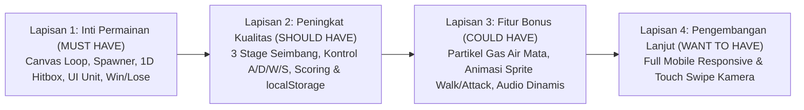
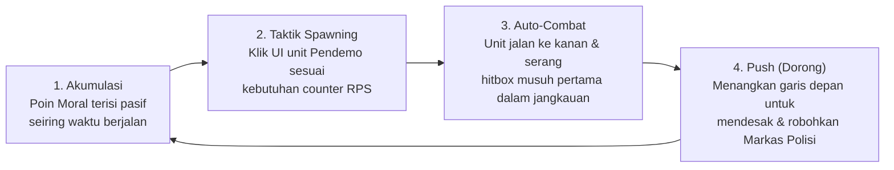
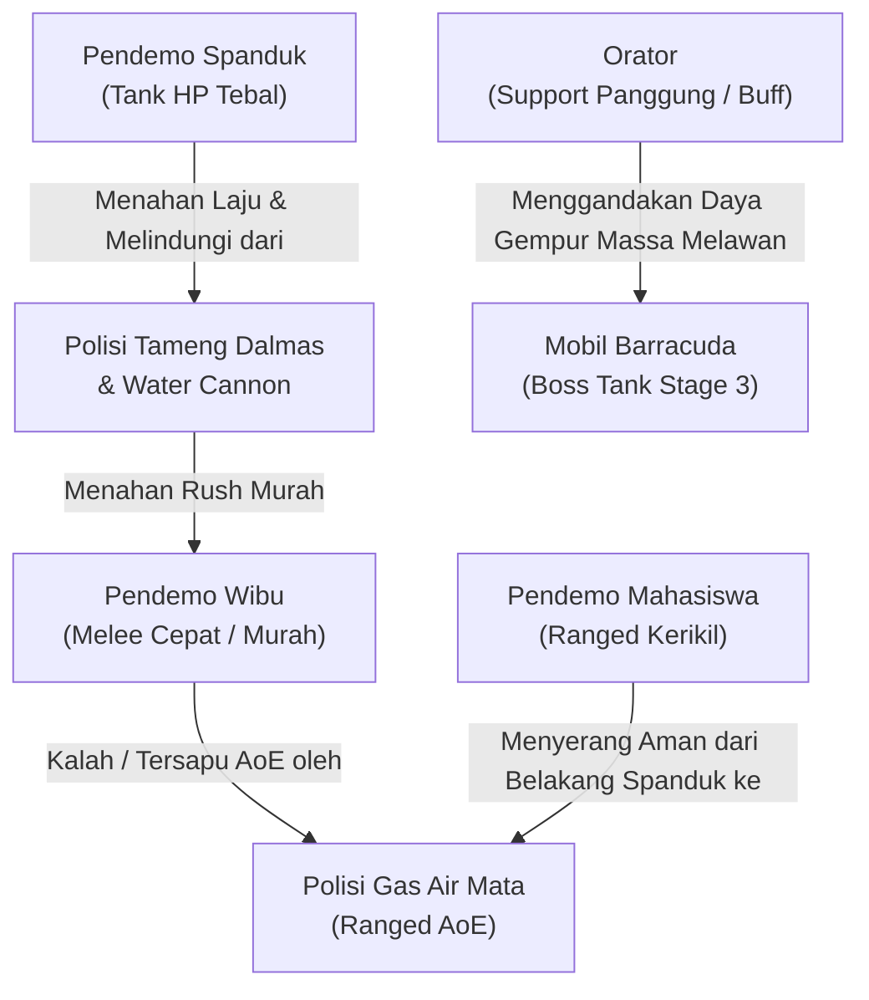
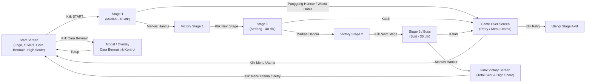
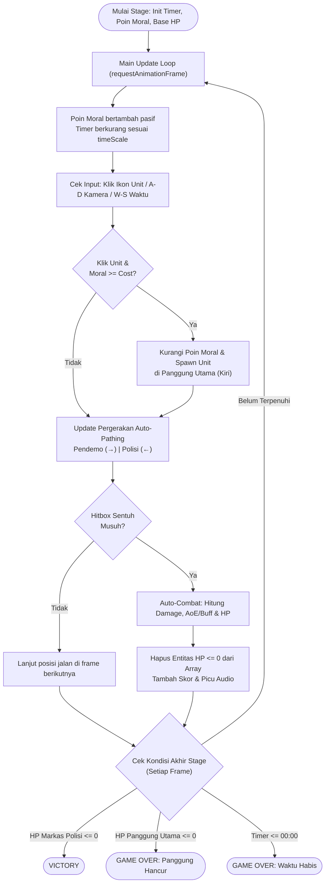
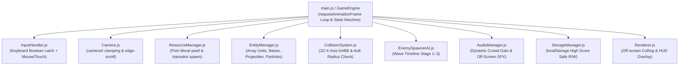

# Product Requirement Document (PRD): *La Voce Del Popolo*

> **Dokumen Spesifikasi Produk, Rekayasa Sistem, Desain Gameplay, & Jaminan Kualitas**  
> Disusun berdasarkan **Game Design Document (GDD) *La Voce Del Popolo*** karya **Kelompok 3 (Bijikers)**

---

## 1. Document Control & Executive Summary

### 1.1 Informasi Kontrol Dokumen

| Atribut Dokumen | Detail Spesifikasi |
| :--- | :--- |
| **Judul Produk** | *La Voce Del Popolo* |
| **Kode Dokumen** | `PRD-LVDP-2026-V1.0` |
| **Versi Dokumen** | `1.0.0` (Baseline Release Specification) |
| **Status Dokumen** | Approved for Development |
| **Dokumen Referensi Utama** | `GDD.docx` (*GDD La Voce Del Popolo*) |
| **Mata Kuliah / Konteks** | Pemrograman Game Berbasis Web — Semester 7 |
| **Tim Pengembang** | **Kelompok 3 (*as Bijikers*)** |
| **Anggota Tim & NIM** | 1. Jastyn Panca Dyxkyr (`2391345027`)<br>2. Ario Jagat Satria (`2391345008`)<br>3. Giebran Mahsa Javier (`2391345041`) |
| **Platform Target** | Web Browser Native (**HTML5 Canvas, CSS3, Vanilla JavaScript ES6+**) |
| **Target Hosting & Distribusi** | Vercel atau GitHub Pages (akses langsung via tautan URL oleh dosen dan penguji) |
| **Genre Produk** | *2D Side-Scrolling Strategy / Tower Defense / Push Strategy (Line Defense)* |

### 1.2 Executive Summary & Product Pitch

***La Voce Del Popolo*** adalah game strategi tarik-ulur berbasis peramban web (*2D side-scrolling tower defense / push strategy*) yang dibangun 100% menggunakan teknologi web native (**HTML5 Canvas, CSS, dan Vanilla JavaScript**) tanpa ketergantungan pada *game engine* eksternal (seperti Phaser, Unity WebGL, atau Construct). Terinspirasi langsung oleh mekanik klasik ***Age of War*** dan ***The Battle Cats***, permainan ini menempatkan pemain sebagai komandan lapangan kelompok massa aksi (Faksi Pendemo) yang bertugas mengatur ekonomi sumber daya secara *real-time* untuk mengerahkan unit-unit aksi dari **Panggung Utama** (Base Kiri) guna menembus barikade **Faksi Kepolisian** dan merobohkan **Markas Polisi** (Base Kanan) sebelum batas waktu habis.

Seluruh sistem—mulai dari *game loop* `requestAnimationFrame`, kontrol kamera horizontal, manipulasi kecepatan waktu (*Fast-Forward 2x* dan *Slow-Mo 0.5x*), deteksi tabrakan *hitbox* sumbu-X, manajemen array entitas, hingga penyimpanan *High Score* lokal—dirancang agar ringan, responsif, mudah diakses melalui satu tautan URL oleh dosen maupun penguji, serta memberikan pengalaman bermain yang padat aksi dalam durasi sesi singkat (35–40 detik per stage).

### 1.3 Player Experience Pillars (Pilar Pengalaman Pemain)

Produk harus dirancang dan divalidasi untuk menghadirkan dua pilar emosi utama sesuai visi GDD:

1. **Resource Management Anxiety (Ketegangan Manajemen Sumber Daya):**
   Pemain terus dihadapkan pada dilema taktis di bawah tekanan waktu (*countdown timer*): apakah harus menabung **Poin Moral** yang beregenerasi pasif untuk memanggil unit berbiaya tinggi berdaya tahan tebal (*Pendemo Spanduk*) atau *support* (*Orator*), atau melakukan *spamming* unit murah (*Pendemo Wibu*) demi menahan gelombang dorongan aparat agar Panggung Utama tidak hancur.
2. **Push & Pull Satisfaction (Kepuasan Tarik-Ulur Garis Depan):**
   Pemain merasakan dinamika pertarungan garis depan (*frontline clash*) yang bergeser ke kiri dan ke kanan di sepanjang jalan raya perkotaan. Ketika komposisi *rock-paper-scissors* berhasil meng-counter formasi polisi, pemain memperoleh kepuasan visual dan auditori (sorakan massa menguat) saat barikade polisi mundur dan Markas Polisi akhirnya runtuh.

### 1.4 Sinopsis Naratif, Tema, & World Setting

| Elemen Dunia & Narasi | Spesifikasi Produk |
| :--- | :--- |
| **Sinopsis Resmi** | Suara rakyat mulai dibungkam. Di jalan raya perkotaan, massa dari berbagai elemen (mahasiswa, wibu, dan masyarakat sipil) bersatu membangun panggung orasi. Mereka harus mendesak maju menembus barikade barisan pertahanan hingga mencapai markas utama dan menyampaikan tuntutan mereka sebelum momentum hilang. |
| **Tema Utama** | Satir Sosial, Kebebasan Berpendapat, Pertahanan Garis (*Line Defense*), dan *Urban Street Riot*. |
| **World Setting** | **Modern Urban 2D** — Latar jalan raya aspal perkotaan dengan deretan gedung bertingkat di latar belakang, panggung orasi di sisi paling kiri arena, serta barikade dan Markas Polisi di sisi paling kanan arena. |
| **Gaya Penyampaian** | Kartun satir / komik **32-Bit Pixel Art** dengan palet warna cerah yang ringan, komunikatif, dan tetap relevan secara sosial tanpa elemen kekerasan realistis (*gore*). |

---

## 2. Target Audience, User Personas & Evaluator Access Goals

### 2.1 Segmentasi Target Pengguna

* **Demografis:** Usia **15+ tahun**, laki-laki dan perempuan.
* **Psikografis:**
  * *Casual browser-game players* yang menginginkan akses permainan instan tanpa unduhan atau instalasi.
  * Penggemar strategi ringan (*line-defense* / *auto-battler* klasik seperti *Age of War*).
  * Kalangan mahasiswa serta penikmat humor satir sosial perkotaan.
* **Stakeholder Khusus (Akademik):** Dosen pengampu dan penguji mata kuliah *Pemrograman Game Berbasis Web* yang menilai game secara langsung melalui tautan publik **Vercel** atau **GitHub Pages**.

### 2.2 User Personas

| Persona | Profil & Latar Belakang | Kebutuhan & Motivasi Utama | Pain Points yang Harus Dihindari | Indikator Keberhasilan Produk |
| :--- | :--- | :--- | :--- | :--- |
| **P-01: Mahasiswa / Casual Browser Gamer** | Usia 18–24 tahun, bermain di sela waktu kuliah lewat laptop atau ponsel. | Sesi permainan cepat (35–40 detik/stage), kontrol klik/keyboard yang langsung dipahami tanpa tutorial panjang, humor satir yang segar. | Waktu loading lama, mekanik terlalu rumit, tombol tidak responsif, tidak tahu unit mana yang meng-counter musuh. | Pemain paham cara spawn unit dan kontrol `A/D/W/S` dalam $< 15$ detik pada percobaan pertama. |
| **P-02: Strategy & Score Chaser** | Penggemar *Age of War* & *The Battle Cats* yang menyukai optimalisasi taktik. | Mengatur komposisi *Tank + Ranged + Support*, memanfaatkan *Slow-Mo* untuk presisi dan *Fast-Forward* untuk tempo cepat, serta memecahkan *High Score*. | *Input stuttering* saat menahan `W`/`S`, kemenangan hanya karena spam satu jenis unit tanpa strategi, skor hilang setelah refresh. | *High Score* tersimpan persisten di `localStorage`, seluruh 4 tipe unit punya peran taktis unik di Stage 2 & 3. |
| **P-03: Dosen & Penguji Akademik** | Menguji karya Kelompok 3 melalui link Vercel / GitHub Pages. | Membuka tautan langsung jalan (*zero setup*), dapat melihat kualitas arsitektur HTML5 Canvas Vanilla JS, keseimbangan 3 stage, serta kesesuaian penuh dengan GDD. | *Broken asset path* (404 di production), error konsol JS, audio memblokir eksekusi loop, atau stage mustahil dimenangkan/terlalu mudah. | 0 error runtime di DevTools Console, ketiga stage dapat ditamatkan secara adil, seluruh fitur GDD berfungsi mulus. |

---

## 3. Product Scope, MVP Priorities (MoSCoW) & Onion Design Architecture

Berdasarkan kerangka **Minimum Viable Product (MVP) & Onion Design** pada GDD, lingkup produk dibagi menjadi **4 lapisan konsentris**. Tim pengembang wajib menyelesaikan lapisan terdalam sebelum mengeksekusi lapisan berikutnya agar versi web selalu berada dalam kondisi *playable* sejak minggu awal.



### 3.1 Matriks Cakupan Produk (MoSCoW Prioritization)

| Prioritas | Lapisan Onion Design | Ruang Lingkup Fitur & Requirement Terkait | Kriteria Selesai (*Exit Criteria*) |
| :--- | :--- | :--- | :--- |
| **Must Have (M)** | **1. Inti Permainan (Kritis untuk MVP)** | • Engine *Game Loop* HTML5 Canvas murni (`requestAnimationFrame`, `update`/`draw` terpisah) tanpa library/engine eksternal.<br>• Sistem regenerasi *Poin Moral* pasif.<br>• UI tombol pembelian/spawning unit pendemo.<br>• Spawner otomatis AI musuh (Faksi Kepolisian).<br>• Sistem *Hitbox Collision* 1D (sumbu X) & kalkulasi HP/Damage.<br>• Sistem *Base Health* (Panggung Utama vs Markas Polisi), Timer Hitung Mundur, dan layar *Victory / Game Over*. | Satu loop permainan utuh dari Start Screen -> pertempuran -> Victory/Game Over berjalan di browser tanpa error. |
| **Should Have (S)** | **2. Peningkat Kualitas** | • 3 Stage dengan kurva kesulitan seimbang (Stage 1 Mudah 40s, Stage 2 Sedang 40s, Stage 3 Sulit/Boss 35s).<br>• Kontrol Kamera horizontal (`A`/`D` atau klik pinggir layar).<br>• Manipulasi Waktu (`Hold W` 2x Fast-Forward, `Hold S` 0.5x Slow-Mo).<br>• Sistem *Scoring* & penyimpanan *High Score* persisten via `localStorage`. | Ketiga stage teruji seimbang; *High Score* bertahan setelah halaman di-reload; kamera dan waktu berjalan mulus. |
| **Could Have (C)** | **3. Fitur Bonus** | • Efek visual partikel (asap gas air mata AoE, semburan water cannon, percikan benturan).<br>• *Sprite sheet animation* berjalan, menyerang, dan hancur untuk semua unit & Mobil Barracuda.<br>• Sistem *Audio Feedback*: sorakan massa dinamis saat mendominasi & SFX benturan/gas air mata untuk indikator pertempuran *off-screen*. | Seluruh animasi state sinkron dengan logika combat dan audio aktif aman terhadap kebijakan autoplay browser. |
| **Want to Have (W)** | **4. Pengembangan Lanjut** | • Tata letak responsif penuh pada *mobile browser*.<br>• Kontrol sentuh (*touch swipe* horizontal untuk menggeser kamera, tombol *on-screen* untuk 2x/0.5x di perangkat tanpa keyboard fisik). | Game nyaman dimainkan di layar ponsel/tablet melalui browser sentuh tanpa elemen terpotong. |

---

## 4. Core Gameplay Loop & Functional Requirements

### 4.1 Core Gameplay Loop (4 Tahap Siklus Taktis)

Permainan berputar dalam siklus waktu-nyata (*real-time loop*) yang berulang sepanjang durasi stage:



1. **Akumulasi:** Pemain memantau **Poin Moral** yang bertambah secara konstan dari detik ke detik.
2. **Taktik Spawning:** Pemain memilih unit dari panel atas (**Wibu**, **Spanduk**, **Mahasiswa**, atau **Orator**) guna merespons komposisi unit polisi yang sedang bergerak maju.
3. **Auto-Combat:** Setelah dipanggil di sisi kiri (*Panggung Utama*), unit berjalan otomatis ke kanan tanpa mikro-kontrol dan langsung bertarung saat *hitbox* jangkauan serangnya menyentuh target lawan.
4. **Push (Dorong):** Keunggulan komposisi menyebabkan unit polisi tumbang terlebih dahulu sehingga gelombang pendemo maju mendesak barikade hingga menghancurkan **Markas Polisi**.

### 4.2 Functional Requirements — Primary Mechanics

| Req ID | Nama Fitur | Spesifikasi Teknis & Perilaku Sistem | Prioritas | Kriteria Validasi |
| :--- | :--- | :--- | :--- | :--- |
| **`FR-PRI-01`** | **Sistem Regenerasi *Poin Moral*** | • Setiap stage dimulai dengan nilai awal `poinMoral = initialMoral` (baseline: `15`).<br>• Setiap frame, nilai bertambah secara kontinu sesuai persamaan:<br>$$M(t + \Delta t) = \min\Big(M_{\max},\; M(t) + R_{\text{regen}} \cdot \Delta t_{\text{eff}}\Big)$$<br>dengan $\Delta t_{\text{eff}} = \Delta t_{\text{raw}} \cdot S_{\text{time}}$ ($S_{\text{time}} \in \{0.5, 1.0, 2.0\}$).<br>• Pembelian unit gagal jika $M(t) < \text{unit.cost}$. Nilai HUD ditampilkan sebagai bilangan bulat (`Math.floor(M)`). | Must Have | Saat `Hold W` (2x), laju isi Poin Moral meningkat 2 kali lipat; saat `Hold S` (0.5x), melambat setengahnya; tidak pernah melebihi $M_{\max}$. |
| **`FR-PRI-02`** | **Unit Spawning, Cooldown & Auto-Pathing** | • Mengklik tombol unit di Top HUD (atau tombol pintas angka `1–4` opsional) memicu validasi: `poinMoral >= unit.cost && cooldown[unitType] <= 0 && playerUnits.length < MAX_PLAYER_UNITS`.<br>• Jika valid: kurangi `poinMoral`, aktifkan timer *spawn cooldown* unit tersebut, dan tambahkan instance unit ke array `entities` pada posisi awal $x = X_{\text{base,kiri}} + \text{offset}$.<br>• **Orator** merupakan pengecualian khusus: ditempatkan di area **Panggung Utama** (posisi statis / *turret support* di base kiri) sesuai definisi GDD.<br>• Unit gerak (Wibu, Spanduk, Mahasiswa) otomatis bergerak ke kanan ($+v_x \cdot \Delta t_{\text{eff}}$) bila status bukan `ATTACK` atau `DEAD`. Unit Polisi bergerak otomatis ke kiri ($-v_x \cdot \Delta t_{\text{eff}}$). | Must Have | Unit muncul di depan Panggung Utama segera setelah tombol diklik; tidak dapat di-spawn selama Poin Moral kurang atau cooldown aktif; berjalan otomatis tanpa input gerak tambahan. |
| **`FR-PRI-03`** | **2D/1D Hitbox Combat (Sumbu-X AABB)** | • Setiap entitas (unit maupun base) memiliki koordinat horizontal $x$, lebar hitbox $w$, jarak serang efektif $r_{\text{atk}}$, dan status `WALK` \| `ATTACK` \| `DEAD`.<br>• **Deteksi Tabrakan/Jangkauan (Sumbu X):** Entitas $A$ mendeteksi target lawan $B$ apabila jarak tepi depan $A$ ke hitbox $B$ memenuhi:<br>$$d(A, B) \le r_{\text{atk}, A}$$<br>di mana untuk faksi Pendemo (menghadap kanan): $(B.x - \frac{B.w}{2}) - (A.x + \frac{A.w}{2}) \le A.\text{range}$ dan $B.x > A.x - \frac{A.w}{2}$.<br>• Jika minimal satu target lawan berada dalam jangkauan, unit berhenti berjalan, masuk ke state `ATTACK`, dan mengeksekusi serangan setiap `attackInterval` detik.<br>• **Tipe Serangan:** *Single-Target* (menyerang lawan terdepan/terdekat) vs *Area-of-Effect / AoE* (melukai seluruh lawan dengan $|x_{\text{impact}} - B.x| \le R_{\text{AoE}}$, khusus *Polisi Gas Air Mata*).<br>• **Lifecycle Cleanup:** Entitas dengan $HP \le 0$ ditandai `DEAD` (atau langsung dihapus via *reverse-loop* `entities.splice(i, 1)` setelah animasi/frame kematian selesai). | Must Have | Unit otomatis berhenti dan bertarung saat menyentuh barisan lawan; unit di belakang yang belum menjangkau musuh tetap maju/menumpuk secara wajar; entitas mati terhapus bersih dari array aktif. |

### 4.3 Functional Requirements — Secondary Mechanics

| Req ID | Nama Fitur | Spesifikasi Teknis & Perilaku Sistem | Prioritas | Kriteria Validasi |
| :--- | :--- | :--- | :--- | :--- |
| **`FR-SEC-01`** | **Kontrol Kamera Horizontal (`A`/`D` & Klik Pinggir Layar)** | • Lebar dunia permainan (*World Width*, misal `2400 px`) lebih lebar daripada lebar viewport Canvas (`1280 px`), sehingga diperlukan pergeseran kamera `cameraX`.<br>• Pemain dapat menggeser kamera ke kiri melalui **tombol `A`**, tombol panah kiri (`ArrowLeft`), atau **menekan/menahan zona tepi kiri layar** (*edge-scroll hotspot*).<br>• Pemain dapat menggeser kamera ke kanan melalui **tombol `D`**, tombol panah kanan (`ArrowRight`), atau **menekan/menahan zona tepi kanan layar**.<br>• Pergerakan kamera menggunakan `dtRaw` (tidak melambat saat *Slow-Mo*) dan dibatasi (*clamped*) pada rentang:<br>$$0 \le \text{cameraX} \le W_{\text{world}} - W_{\text{viewport}}$$ | Should Have | Pemain dapat meninjau Panggung Utama di kiri penuh (`cameraX = 0`) maupun Markas Polisi di kanan penuh (`cameraX = max`) secara mulus bahkan ketika simulasi di-Slow-Mo. |
| **`FR-SEC-02`** | **Manipulasi Waktu Taktis (`Hold W` / `Hold S`)** | • Kecepatan simulasi default `timeScale = 1.0`.<br>• Saat tombol **`W` ditahan**, `timeScale = 2.0` (*Fast-Forward 2x*).<br>• Saat tombol **`S` ditahan**, `timeScale = 0.5` (*Slow-Mo 0.5x*).<br>• Jika `W` dan `S` dilepas bersamaan (atau ditekan bersamaan sebagai *tie-breaker*), `timeScale = 1.0`.<br>• **Wajib State-Based:** Status penekanan tombol disimpan sebagai boolean (`isSpeedUp`, `isSlowDown`) pada event `keydown`/`keyup` dan dievaluasi di `update()`, bukan mengandalkan repetisi event `keydown` browser. | Should Have | Menahan `W` mempercepat gerak unit, serangan, regenerasi Poin Moral, dan laju hitung mundur timer tepat 2x; menahan `S` memperlambat seluruhnya menjadi 0.5x tanpa *stuttering*. |
| **`FR-SEC-03`** | **Base Health System (Win / Lose Condition)** | • **Panggung Utama (Base Kiri)** memiliki $HP_{\text{playerBase}}$ dan bar HP di sisi kiri arena.<br>• **Markas Polisi (Base Kanan)** memiliki $HP_{\text{enemyBase}}$ dan bar HP di sisi kanan arena.<br>• Kedua base dapat diserang oleh unit lawan ketika jarak ke tepi base $\le \text{unit.range}$.<br>• Jika $HP_{\text{enemyBase}} \le 0$ lebih dulu $\rightarrow$ Stage berakhir seketika dengan status **VICTORY**.<br>• Jika $HP_{\text{playerBase}} \le 0$ lebih dulu $\rightarrow$ Stage berakhir seketika dengan status **GAME OVER (Panggung Hancur)**. | Must Have | Status kemenangan/kekalahan langsung terpicu pada frame yang sama saat HP salah satu markas mencapai 0; bar HP berkurang proporsional saat menerima damage. |
| **`FR-SEC-04`** | **Timer Hitung Mundur (*Stage Countdown*)** | • Setiap stage memiliki batas waktu ketat sesuai GDD: **Stage 1 = `40` detik**, **Stage 2 = `40` detik**, **Stage 3 = `35` detik**.<br>• Timer berkurang sebesar $\Delta t_{\text{eff}} = \Delta t_{\text{raw}} \cdot S_{\text{time}}$ setiap frame selama stage aktif.<br>• Ditampilkan dalam format `MM:SS` (misal `00:40`) pada Top HUD.<br>• Apabila `timeRemaining <= 0` sebelum Markas Polisi hancur $\rightarrow$ memicu **GAME OVER (Waktu Habis)**. | Must Have | Timer berjalan akurat sinkron dengan `timeScale` (`W`/`S`), berhenti tepat pada layar Victory/Game Over, dan kalah otomatis saat `00:00`. |

### 4.4 Functional Requirements — Tertiary Mechanics

| Req ID | Nama Fitur | Spesifikasi Teknis & Perilaku Sistem | Prioritas | Kriteria Validasi |
| :--- | :--- | :--- | :--- | :--- |
| **`FR-TER-01`** | **Sistem Scoring & Bonus Penyelesaian** | • Pemain memperoleh skor secara *real-time* setiap kali mengeliminasi unit polisi dan merusak/merobohkan barikade/markas:<br>$$\text{Score}_{\text{stage}} = \sum \text{KillScore} + \text{BarricadeDamageBonus} + \text{TimeBonus}$$<br>• *TimeBonus* hanya diberikan saat **Victory**: $\lfloor t_{\text{sisa}} \rfloor \times 25$ poin.<br>• Pada alur multi-stage berkelanjutan (*Stage 1 $\rightarrow$ 2 $\rightarrow$ 3*), skor kumulatif diakumulasi untuk mencatatkan skor total sesi tertinggi. | Should Have | Indikator Skor di Top HUD bertambah langsung tiap musuh tumbang; skor akhir ditampilkan lengkap pada layar Victory/Game Over. |
| **`FR-TER-02`** | **Persistensi High Score (`localStorage`)** | • Sistem menyimpan rekor skor tertinggi pada kunci `lvdp_high_score` di `window.localStorage`.<br>• Saat Start Screen dimuat, nilai `High Score` dibaca dan ditampilkan (default `0000` jika belum ada data).<br>• Setiap kali game berakhir (*Game Over* atau *Victory* Stage 3, serta pembaruan skor pasca-stage), jika `totalScore > savedHighScore`, simpan nilai baru ke `localStorage`. | Should Have | Setelah halaman browser di-refresh atau tab ditutup lalu dibuka ulang, nilai High Score sebelumnya tetap tampil akurat. |
| **`FR-TER-03`** | **Dynamic Audio Feedback & Off-Screen Combat Indicator** | • **Sorakan Massa Dinamis:** Volume dan intensitas track audio sorakan massa aksi meningkat secara halus (*smooth gain interpolation*) saat rasio dominasi posisi garis depan pendemo melewati $50\%$ lebar arena atau jumlah unit pendemo unggul jauh atas polisi.<br>• **Indikator Pertempuran Off-Screen:** Ketika unit bertarung di luar area kamera yang sedang terlihat (`unit.x < cameraX` atau `unit.x > cameraX + viewportW`), SFX spesifik (benturan tameng Dalmas, ledakan tabung Gas Air Mata, semburan Water Cannon, raungan Mobil Barracuda) tetap diputar dengan atenuasi terukur agar pemain tahu ada kontak tempur di sisi layar lain. | Could Have | Pemain mendengar sorakan massa makin riuh saat mendorong musuh mendekati markas polisi, dan tetap mendengar bunyi benturan meski kamera digeser menjauh ke base kiri. |

---

## 5. Spesifikasi Faksi, Unit & Matriks *Rock-Paper-Scissors* (RPS Balancing)

### 5.1 Sistem Counter *Rock-Paper-Scissors* (Fundamental Core Game)

Sesuai GDD Bab 2 (*Fundamental Core Game*), game menerapkan sistem *rock-paper-scissors* berjenjang agar pemain tidak bisa menang hanya dengan menekan satu tombol secara membabi-buta, terutama mulai Stage 2 dan Stage 3:



| Unit Pemain (Pendemo) | Kuat Melawan (*Counter To*) | Lemah Terhadap (*Countered By*) | Peran Taktis Dalam Formasi |
| :--- | :--- | :--- | :--- |
| **Pendemo Wibu** | *Polisi Tameng Dalmas* awal (lewat jumlah banyak / DPS murah), merusak *Markas Polisi* secara cepat jika jalan terbuka. | *Polisi Gas Air Mata* (karena HP tipis mudah mati serentak terkena AoE), *Polisi Water Cannon* (terpukul mundur / terhambat). | **Early Skirmisher / Zerg Rush** — menahan laju Dalmas pertama sembari menabung untuk Tank/Ranged. |
| **Pendemo Spanduk** | *Polisi Tameng Dalmas* & *Polisi Water Cannon* (menyerap serangan & menahan posisi garis depan); menyerap ledakan *Gas Air Mata*. | *Mobil Barracuda* (tanpa dukungan DPS Ranged/Orator akan hancur perlahan karena damage Spanduk rendah). | **Frontline Anchor / Meatshield** — tembok hidup pelindung barisan Mahasiswa di belakangnya. |
| **Pendemo Mahasiswa** | *Polisi Gas Air Mata* & *Polisi Tameng Dalmas* dari jarak aman; sumber DPS utama untuk meruntuhkan *Mobil Barracuda* & *Markas Polisi*. | Serangan langsung jarak dekat apabila tidak ada *Pendemo Spanduk* di depan (HP relatif tipis). | **Backline Ranged DPS** — pelempar kerikil beruntun dari belakang perisai Spanduk. |
| **Orator** | Formasi pertahanan berlapis di Stage 2–3 serta *Mobil Barracuda* (mempercepat serangan & gerak seluruh massa aksi agar barisan tidak kandas oleh timer 35s). | Tidak bertarung langsung di garis depan; membuang Poin Moral jika dipanggil saat lapangan masih kosong tanpa unit tempur. | **Force Multiplier (Turret/Support Panggung)** — berada di panggung kiri dan menyiarkan *buff* orasi ke seluruh unit pendemo aktif. |

### 5.2 Spesifikasi Detail Unit — Faksi Pendemo (Player Units)

1. **`UNIT_P_WIBU` — Pendemo Wibu (Melee Dasar)**
   * **Perilaku AI:** Berlari cepat ke arah kanan; menyerang target polisi pertama dalam jarak dekat menggunakan ayunan barang atribut/lightstick satir secara bertubi-tubi.
   * **Profil Stat:** Biaya Poin Moral paling murah, HP rendah, kecepatan gerak paling tinggi, interval serang sangat cepat, damage per detik moderat.
   * **Referensi Konsep GDD:** *Image `image11.png` (Referensi konsep gestur enerjik aksi jalanan dari GDD).*
2. **`UNIT_P_SPANDUK` — Pendemo Spanduk (Tank Garis Depan)**
   * **Perilaku AI:** Berjalan lambat ke kanan sambil membentangkan spanduk tuntutan besar yang berfungsi sebagai tameng fisik; berhenti saat berhadapan dengan barikade polisi dan melakukan dorongan/hantaman spanduk.
   * **Profil Stat:** Biaya menengah, HP sangat tebal, kecepatan gerak lambat, damage rendah, resistensi dorong tinggi terhadap semburan *Water Cannon*.
   * **Referensi Konsep GDD:** *Image `image3.png` (Referensi konsep pembawa spanduk aksi dari GDD).*
3. **`UNIT_P_MAHASISWA` — Pendemo Mahasiswa (Ranged DPS)**
   * **Perilaku AI:** Berjalan ke kanan hingga target polisi berada dalam radius lempar jarak jauh (`range` lebar), lalu berhenti di belakang barisan *Pendemo Spanduk* untuk melontarkan proyektil kerikil secara berkala.
   * **Profil Stat:** Biaya menengah, HP sedang-rendah, kecepatan gerak sedang, damage proyektil tinggi terhadap target tunggal (*single-target*).
   * **Referensi Konsep GDD:** *Image `image6.png` (Referensi konsep pelempar jarak jauh dari GDD).*
4. **`UNIT_P_ORATOR` — Orator (Support / Turret Panggung)**
   * **Perilaku AI:** Sesuai GDD, Orator **berdiri di atas Panggung Utama** (base kiri) sebagai unit *Support/Turret* dengan megaphone. Selama aktif (durasi aktif atau hingga batas *cap* aktif di panggung), Orator memancarkan gelombang suara orasi yang memberikan **Buff Global** kepada seluruh unit pendemo yang sedang bertempur (peningkatan *Attack Speed* dan *Movement Speed* / *Damage*), serta secara opsional ikut memicu lonjakan energi dorong garis depan.
   * **Profil Stat:** Biaya tinggi, tidak bergerak maju (*stationary on stage*), tidak menerima damage langsung di garis depan (atau bertahan sesuai durasi orasi / kondisi Panggung Utama), maksimal aktif bersamaan dibatasi (misal `maxStack = 2` agar tidak merusak keseimbangan permainan).
   * **Referensi Konsep GDD:** *Image `image10.png` (Referensi konsep orator bermegafon dari GDD).*

### 5.3 Spesifikasi Detail Unit — Faksi Kepolisian (Enemy AI Units)

1. **`UNIT_E_DALMAS` — Polisi Tameng Dalmas (Melee Frontliner)**
   * **Perilaku AI:** Berjalan maju ke kiri dengan formasi tameng anti-huru-hara; menahan dorongan unit pendemo di garis depan dan memukul mundur barisan melee terdekat.
   * **Profil Stat:** HP kokoh (lebih tebal daripada *Pendemo Wibu*), kecepatan gerak sedang, damage melee moderat, menjadi unit tulang punggung di Stage 1–3.
   * **Referensi Konsep GDD:** *Image `image15.png` (Referensi konsep polisi bertameng dari GDD).*
2. **`UNIT_E_GASAIRMATA` — Polisi Gas Air Mata (Ranged AoE)**
   * **Perilaku AI:** Berjalan hingga jarak tembak menengah-jauh, lalu menembakkan/melempar tabung gas air mata ke titik kontak terdepan. Saat menyentuh tanah, tercipta awan asap beracun **Area-of-Effect (AoE)** yang melukai seluruh unit pendemo dalam radius ledakan sekaligus.
   * **Profil Stat:** Muncul mulai Stage 2; HP sedang, serangan interval agak lambat namun sangat mematikan terhadap gerombolan *Pendemo Wibu*.
   * **Referensi Konsep GDD:** *Image `image13.png` (Referensi konsep efek asap gas air mata di jalan raya dari GDD).*
3. **`UNIT_E_WATERCANNON` — Polisi Water Cannon (Turret / Support Penahan Laju)**
   * **Perilaku AI:** Kendaraan taktis pendukung jarak jauh yang menembakkan semburan air bertekanan tinggi ke garis depan. Serangan memberikan damage ringan sekaligus efek **Knockback / Slow (pengurangan Move Speed sementara)** untuk menahan laju *push* massa pendemo.
   * **Profil Stat:** Muncul di Stage 2 akhir & Stage 3; HP tebal, jarak serang panjang, bertindak sebagai pengulur waktu demi menguntungkan timer polisi.
   * **Referensi Konsep GDD:** *Image `image1.png` (Referensi konsep truk water cannon dari GDD).*
4. **`UNIT_E_BARRACUDA` — Mobil Barracuda (Tank / Boss Stage 3)**
   * **Perilaku AI:** Kendaraan taktis lapis baja berat yang muncul sebagai **Boss utama di Stage 3**. Melaju stabil ke kiri dan menggilas/menghantam barisan depan pendemo dengan damage tinggi dan HP masif.
   * **Profil Stat:** HP ekstrem (Boss-tier), kebal atau sangat resisten terhadap efek *knockback*, memberikan damage tinggi terhadap *Pendemo Spanduk* maupun *Panggung Utama* jika berhasil menembus garis pertahanan.
   * **Referensi Konsep GDD:** *Image `image14.png` (Referensi konsep kendaraan lapis baja Barracuda dari GDD).*

### 5.4 Tabel Parameter Statistik Baseline (Acuan Balancing Development & Minggu 5)

> *Catatan Rekayasa:* Angka di bawah merupakan **parameter baseline awal** yang dirumuskan dari deskripsi karakteristik GDD (*murah/mahal, lambat/cepat, HP tebal/tipis*) untuk disimpan dalam file konfigurasi terpusat (`config/units.js`) agar mudah dituning pada fase *Balancing* (Minggu 5).

| ID Entitas | Nama Entitas | Tipe / Role | Cost (Moral) | Spawn CD (dtk) | Max HP | Damage / Hit | Atk Interval (dtk) | Range (px) | Move Speed (px/s) | Efek Khusus (AoE / Buff / Slow) | Hitbox W x H (px) | Kill Score |
| :--- | :--- | :--- | :---: | :---: | :---: | :---: | :---: | :---: | :---: | :--- | :---: | :---: |
| **`UNIT_P_WIBU`** | Pendemo Wibu | Player Melee | `10` | `1.2` | `75` | `14` | `0.65` | `28` | `95` | Serangan cepat; sangat rentan AoE | `44 x 64` | — |
| **`UNIT_P_SPANDUK`** | Pendemo Spanduk | Player Tank | `25` | `3.5` | `320` | `10` | `1.40` | `32` | `48` | Penyerap damage; tahan 70% knockback | `68 x 72` | — |
| **`UNIT_P_MAHASISWA`** | Pendemo Mahasiswa | Player Ranged | `20` | `2.5` | `90` | `24` | `1.15` | `220` | `68` | Proyektil kerikil jarak jauh | `46 x 66` | — |
| **`UNIT_P_ORATOR`** | Orator | Player Support | `35` | `8.0` | `N/A` (Durasi `15s`) | `0` | `N/A` | Global | `0` (Panggung) | Buff aktif seluruh unit: `+25% Atk Spd`, `+15% Move Spd` (Maks 2 stack) | `52 x 74` | — |
| **`UNIT_E_DALMAS`** | Polisi Tameng Dalmas | Enemy Melee | — | AI | `160` | `14` | `1.00` | `30` | `58` | Tameng kokoh penahan dorongan | `52 x 70` | `100` |
| **`UNIT_E_GASAIRMATA`** | Polisi Gas Air Mata | Enemy Ranged AoE | — | AI | `110` | `18` | `2.20` | `250` | `52` | Ledakan AoE radius `95 px` (kena semua pendemo di area) | `50 x 68` | `180` |
| **`UNIT_E_WATERCANNON`** | Polisi Water Cannon | Enemy Turret/Support | — | AI | `380` | `12` | `1.80` | `290` | `36` | Semburan AoE radius `80 px` + Slow `-40% Speed` (`1.5s`) + Knockback `12 px` | `120 x 88` | `300` |
| **`UNIT_E_BARRACUDA`** | Mobil Barracuda | Enemy Boss / Tank | — | Boss AI | `1100` | `38` | `1.60` | `45` | `32` | Boss Stage 3; kebal knockback; damage ganda ke Panggung (`1.5x`) | `160 x 104` | `1000` |
| **`BASE_PLAYER`** | Panggung Utama | Player Base (Kiri) | — | Static | `1000` | — | — | — | `0` | Hancur = Game Over seketika | `180 x 220` | — |
| **`BASE_ENEMY_S1`** | Markas Polisi (Stg 1) | Enemy Base (Kanan) | — | Static | `650` | — | — | — | `0` | Hancur = Victory Stage 1 | `180 x 220` | `500` |
| **`BASE_ENEMY_S2`** | Markas Polisi (Stg 2) | Enemy Base (Kanan) | — | Static | `950` | — | — | — | `0` | Hancur = Victory Stage 2 | `180 x 220` | `750` |
| **`BASE_ENEMY_S3`** | Markas Polisi (Stg 3) | Enemy Base (Kanan) | — | Static | `1200` | — | — | — | `0` | Hancur = Victory Stage 3 (Tamat) | `180 x 220` | `1200` |

---

## 6. Level Design, Stage Progression & Spesifikasi AI Spawner

### 6.1 Matriks Progresi 3 Stage

Sesuai GDD Bab 7 (*Level Design & Encounters*), game terdiri dari **3 Stage berjenjang** dengan batas waktu tegas agar pemain terdorong bermain agresif (*push strategy*) dan tidak melakukan *turtling* pasif:

| Stage | Tingkat Kesulitan | Laju Spawn Musuh | Batas Waktu | Poin Moral Awal & Regen | Target & Tantangan Desain |
| :--- | :--- | :--- | :---: | :--- | :--- |
| **Stage 1** | **Mudah** | **Lambat** (`interval ~4.5s`) | **40 Detik** | Awal: `20` \| Regen: `5.0/s` | Pengenalan mekanik dasar (*onboarding*). Musuh hanya **Polisi Tameng Dalmas**. Pemain belajar menekan tombol spawn, menggeser kamera `A`/`D`, dan mendorong hingga Markas Polisi roboh. |
| **Stage 2** | **Sedang** | **Menengah** (`interval ~3.2s`) | **40 Detik** | Awal: `25` \| Regen: `6.0/s` | Kemunculan **Polisi Gas Air Mata (AoE)** dan dukungan **Water Cannon**. Pemain dipaksa menerapkan komposisi *Pendemo Spanduk* (Tank depan) + *Pendemo Mahasiswa* (Ranged belakang) agar tidak habis disapu AoE. |
| **Stage 3** | **Sulit / Boss** | **Cepat** (`interval ~2.4s`) | **35 Detik** | Awal: `30` \| Regen: `7.5/s` | Waktu lebih singkat (35 detik) dengan pengerahan **Mobil Barracuda (Boss)** bersama Dalmas, Gas Air Mata, & Water Cannon. Pemain harus menggabungkan **Hold W (2x)** untuk akumulasi/dorongan cepat, **Orator**, serta **spam unit secara presisi**. |

### 6.2 Jadwal Gelombang AI Spawner (*Wave Timeline Specification*)

Untuk menjamin determinisme dan konsistensi pengujian oleh dosen maupun penguji, spawner AI musuh menggunakan kombinasi **Scheduled Wave Events** dan **Periodic Reinforcement**:

1. **Stage 1 — *Jalan Protokol Awal* (40 Detik):**
   * `t = 1.5s`: Spawn `1x Dalmas` (pemicu konflik garis tengah).
   * `t = 6.0s` s.d. `36.0s` (tiap `4.5s`): Spawn `1x Dalmas`.
   * Pada saat HP Markas Polisi `< 50%` (emergency defense trigger, maksimal 1x): Spawn `2x Dalmas` beriringan.
2. **Stage 2 — *Kepungan Gas Air Mata* (40 Detik):**
   * `t = 1.5s`: Spawn `1x Dalmas`.
   * `t = 5.0s`: Spawn `1x Dalmas` + `1x Gas Air Mata` (menguji apakah pemain sudah menyiapkan *Pendemo Spanduk*).
   * `t = 10.0s` s.d. `35.0s` (tiap `3.2s`): Pola bergantian `(Dalmas)`, `(Dalmas + Gas Air Mata)`, `(Water Cannon di t = 16.0s & t = 28.0s)`.
3. **Stage 3 — *Operasi Barracuda* (35 Detik):**
   * `t = 1.0s`: Spawn `2x Dalmas` + `1x Gas Air Mata` (tekanan awal langsung terasa).
   * `t = 4.5s`: **BOSS ALERT** — Spawn **`1x Mobil Barracuda`** dikawal `1x Dalmas`.
   * `t = 8.0s` s.d. `32.0s` (tiap `2.4s`): Rotasi intensif `(Dalmas + Gas Air Mata)`, `(Water Cannon di t = 13.0s & t = 24.0s)`, serta `1x Barracuda` tambahan apabila HP Markas `< 40%` dan tidak ada Barracuda lain di arena.

---

## 7. Spesifikasi UI/UX, Wireframe & Game Flow

### 7.1 Arsitektur Navigasi & Alur Makro Permainan



### 7.2 Alur Runtime Dalam Satu Stage (*In-Stage Micro Flow*)



### 7.3 Spesifikasi Layar & Pemetaan Komponen Wireframe

#### A. Start Screen (`SCR-01`)
Mengacu pada *Wireframe - Start Screen* di GDD:
1. **Header Logo / Key Art:** Banner judul **LA VOCE DEL POPOLO** di bagian tengah-atas layar.
2. **Tombol `START`:** Tombol aksi utama berukuran besar yang langsung memulai Stage 1 sekaligus menginisialisasi konteks audio browser (*Web Audio API unlock*).
3. **Tombol `Cara Bermain`:** Membuka panel overlay ringkas berisi penjelasan kontrol (`Klik Unit`, `A/D Kamera`, `W 2x`, `S 0.5x`), tujuan menghancurkan Markas Polisi sebelum timer habis, serta panduan singkat *counter* RPS antar unit.
4. **Panel `High Score: 0000`:** Menampilkan nilai skor tertinggi yang dibaca dari `localStorage`.

#### B. HUD In-Game Side-Scrolling (`SCR-02`)
Mengacu pada *Wireframe - HUD In-Game (Side-Scrolling)* di GDD:
1. **Top HUD Bar (Tetap / Fixed di Atas Layar):**
   * Kiri: Kotak **`Poin Moral`** (menampilkan angka berjalan real-time dan kapasitas maksimum).
   * Tengah: **4 Kotak Ikon Unit** berjajar horizontal:
     * `Wibu (Cost)` | `Spanduk (Cost)` | `Mahasiswa (Cost)` | `Orator (Cost)`
     * Setiap tombol menampilkan ikon unit, nama singkat, harga *Poin Moral*, indikator *cooldown* radial/bar vertikal, dan status visual redup (*disabled*) ketika `poinMoral < cost`.
   * Kanan: Kotak **`Timer`** (`00:40` / `00:35`) yang berkedip merah saat tersisa `< 10` detik, serta kotak **`Skor`** (`0000`) dan tombol pause/mute kecil opsional di sudut aman.
2. **World-Space Base Status & Arena:**
   * **`HP Panggung [=====]`** berada tepat di atas struktur **Panggung Utama (Base kiri)** di dunia permainan.
   * **`HP Markas [=====]`** berada tepat di atas struktur **Markas Polisi (Base kanan)** di dunia permainan.
   * **Area Jalan Raya:** Jalur tempur 2D di mana unit pendemo berjalan ke kanan (`→`) dan unit polisi berjalan ke kiri (`←`), dilengkapi indikator arah mini apabila pertempuran berlangsung di luar pandangan kamera.
3. **Bottom Control Hint Bar:**
   * Pita instruksi semi-transparan di bagian bawah HUD: **`A/D geser kamera | W: Fast Forward 2x | S: Slow-Mo 0.5x`** (sekaligus menampilkan status kecepatan aktif seperti badge `2.0x` atau `0.5x` ketika tombol sedang ditahan).

#### C. Victory / Game Over Screen (`SCR-03`)
Mengacu pada *Wireframe - Victory / Game Over* di GDD:
1. **Header Status Banner:** Menampilkan **`VICTORY`** (warna hijau/emas) atau **`GAME OVER`** (warna merah peringatan) beserta sub-pesan penyebab spesifik (misal *"Markas Polisi Berhasil Diruntuhkan!"*, *"Panggung Orasi Hancur!"*, atau *"Momentum Hilang — Waktu Habis!"*).
2. **Panel Ringkasan Statistik:**
   * `Skor akhir: 0000` (disertai badge `NEW HIGH SCORE!` jika melampaui rekor).
   * `High Score: 0000`
   * `Sisa waktu: 00 detik`
3. **Baris Tombol Aksi:**
   * **`Retry`**: Mengulang langsung stage yang baru dimainkan.
   * **`Next Stage`**: Aktif/tampil saat status `VICTORY` pada Stage 1 atau Stage 2 untuk langsung melanjutkan ke Stage berikutnya.
   * **`Menu Utama`**: Kembali ke Start Screen (`SCR-01`).

### 7.4 Tabel Pemetaan Input & Kontrol Lintas Perangkat

| Aksi Pemain | Input Mouse / Desktop | Input Keyboard | Input Touch (Lapisan 4 Mobile) | Respons Sistem |
| :--- | :--- | :--- | :--- | :--- |
| **Spawn Unit Pendemo** | Klik kiri pada salah satu dari 4 kotak ikon unit di Top HUD | Opsional pintasan tombol angka `1`, `2`, `3`, `4` | Tap langsung pada kotak ikon unit di Top HUD | Validasi Poin Moral & cooldown $\rightarrow$ spawn unit di Panggung Utama |
| **Geser Kamera Kiri** | Klik/tahan zona pinggir kiri layar (hotspot) | Tahan **`A`** atau **`ArrowLeft`** | Swipe jari ke kanan pada area kanvas (*pan left*) | Mengurangi `cameraX` hingga minimum `0` |
| **Geser Kamera Kanan** | Klik/tahan zona pinggir kanan layar (hotspot) | Tahan **`D`** atau **`ArrowRight`** | Swipe jari ke kiri pada area kanvas (*pan right*) | Menambah `cameraX` hingga `WorldWidth - ViewportWidth` |
| **Fast-Forward Waktu (2x)** | Opsional tombol UI `2x` (*hold/toggle*) | Tahan **`W`** atau **`ArrowUp`** | Sentuh & tahan tombol HUD `2x` | Mengatur `timeScale = 2.0` selama tombol ditahan |
| **Slow-Motion Waktu (0.5x)** | Opsional tombol UI `0.5x` (*hold/toggle*) | Tahan **`S`** atau **`ArrowDown`** | Sentuh & tahan tombol HUD `0.5x` | Mengatur `timeScale = 0.5` selama tombol ditahan |
| **Navigasi Menu** | Klik kiri pada tombol menu (`START`, `Retry`, `Next Stage`, dll.) | `Enter` / `Space` (konfirmasi opsional) | Tap tombol menu | Transisi state layar game |

---

## 8. Spesifikasi Art Direction, Animasi & Audio Engineering

### 8.1 Art Direction & Spesifikasi Palet Warna

* **Gaya Visual:** **32-Bit Pixel Art** dengan proporsi komik/kartun satir (*expressive silhouettes*) dan pembacaan (*readability*) tinggi di atas latar jalan raya.
* **Aturan Rendering Canvas:** Menggunakan `ctx.imageSmoothingEnabled = false` agar piksel sprite tetap tajam tanpa buram saat diskalakan.
* **Kontras Faksi Wajib:** Faksi Kepolisian didominasi nuansa dingin/resmi (**Biru Gelap & Abu-Abu Baja**), sedangkan Faksi Pendemo memakai warna **Kasual Cerah & Kontras Hangat** di atas **Aspal Abu-Abu Netral**.

| Kategori Elemen | Nama Token Warna | Kode HEX | Penggunaan Visual |
| :--- | :--- | :---: | :--- |
| **Environment** | Aspal Jalan Raya | `#3E4249` / `#2D3036` | Permukaan jalan utama pertempuran & garis marka jalan `#CBD5E1` |
| **Environment** | Siluet Kota Urban | `#1E2430` / `#334155` | Lapisan gedung bertingkat latar belakang (*parallax*) |
| **Faksi Polisi** | Seragam & Tameng Polisi | `#1E3A8A` / `#475569` | Baju Dalmas, tameng taktis, helm huru-hara, bodi truk & Barracuda |
| **Faksi Pendemo** | Aksen Rakyat & Orasi | `#EA580C` / `#DC2626` | Ikat kepala, panggung orasi, spanduk tuntutan, almamater warna-warni (`#2563EB`, `#16A34A`, `#9333EA`) |
| **UI & HUD** | Panel HUD Kontras | `#18181B` (bg) / `#F59E0B` (border) | Panel Top HUD, ikon unit, angka Poin Moral (`#FBBF24`), tombol menu |
| **Status Indikator** | HP Bar & Feedback | `#22C55E` (Aman) / `#EF4444` (Kritis) | HP Panggung Utama, HP Markas Polisi, flash merah saat unit terkena hit |

### 8.2 Inventaris Aset Visual (*Asset Manifest*)

| Asset ID | Kategori | Nama Aset | State Animasi / Varian yang Dibutuhkan |
| :--- | :--- | :--- | :--- |
| `SPR-P-WIBU` | Sprite Sheet Unit | Pendemo Wibu | `Walk` (4–6 frame), `Attack` (4 frame), `Death/KO` (2–3 frame) |
| `SPR-P-SPANDUK` | Sprite Sheet Unit | Pendemo Spanduk | `Walk` (4 frame), `Attack` (4 frame), `Death/KO` (3 frame) |
| `SPR-P-MAHASISWA` | Sprite Sheet Unit | Pendemo Mahasiswa | `Walk` (4–6 frame), `Attack/Throw` (4 frame), `Death/KO` (2–3 frame) |
| `SPR-P-ORATOR` | Sprite Sheet Support | Orator Panggung | `Idle/Orasi` (4 frame gelombang suara megaphone) |
| `SPR-E-DALMAS` | Sprite Sheet Musuh | Polisi Tameng Dalmas | `Walk` (4 frame), `Attack` (4 frame), `Death/Retreat` (3 frame) |
| `SPR-E-GAS` | Sprite Sheet Musuh | Polisi Gas Air Mata | `Walk` (4 frame), `Shoot/Throw` (4 frame), `Death` (3 frame) |
| `SPR-E-WATER` | Sprite Sheet Musuh | Polisi Water Cannon | `Drive/Walk` (2–4 frame roda), `Spray` (4 frame semburan), `Destroy` (3 frame) |
| `SPR-E-BARRACUDA` | Sprite Sheet Boss | Mobil Barracuda | `Drive` (4 frame roda & sirine), `Ram/Attack` (4 frame), `Destroy` (4 frame asap/api) |
| `STR-BASE-LEFT` | Struktur Base | Panggung Utama Pendemo | Kondisi Utuh, Rusak (`<50% HP`), Hancur (`0% HP`) |
| `STR-BASE-RIGHT` | Struktur Base | Markas Polisi | Kondisi Utuh, Rusak (`<50% HP`), Hancur (`0% HP`) |
| `VFX-PROJ` | Proyektil & Partikel | Kerikil, Tabung & Asap Gas Air Mata, Semburan Air, Percikan Hit | Proyektil bergerak & animasi partikel lingkaran/pixel |
| `ENV-URBAN` | Latar Belakang | Langit Urban, Gedung Bertingkat (Parallax), Jalan Aspal & Trotoar | Tileable / seamless sepanjang `WorldWidth` (`2400 px`) |
| `UI-ART` | Elemen Antarmuka | Key Art Start Screen (`La Voce Del Popolo`), 4 Ikon Unit HUD | PNG beresolusi bersih untuk HUD & Start Screen |

### 8.3 Inventaris Aset Audio (*Audio Manifest & Trigger Rules*)

| Audio ID | Tipe | Nama & Karakteristik Suara | Kondisi Pemicu (*Trigger*) | Perilaku Khusus (*Mixing / Off-Screen*) |
| :--- | :--- | :--- | :--- | :--- |
| `AUD-BGM-MENU` | BGM (Loop) | Tema satir perkotaan ritmis ringan | Start Screen (setelah interaksi klik pertama) | Volume moderat (`0.35`), fade-out saat masuk Stage |
| `AUD-BGM-BATTLE` | BGM (Loop) | Beat enerjik aksi massa & perkusi jalanan | Selama Stage 1–3 aktif | Tempo/playback rate opsional atau tetap stabil; pause saat Game Over/Victory |
| `AUD-AMB-CROWD` | Ambient Loop | **Sorakan Massa Aksi** | Aktif selama pertempuran berlangsung | Volume adaptif (`0.1` s.d. `0.8`) mengikuti rasio dominasi garis depan pendemo sesuai GDD |
| `AUD-SFX-SPAWN` | SFX | Suara peluit / klik tegas memanggil unit | Setiap berhasil spawn unit pendemo | Debounce minimal `60 ms` |
| `AUD-SFX-SHIELD` | SFX | **Benturan Tameng / Pukulan Melee** | Saat serangan melee Wibu / Spanduk / Dalmas mengenai target | **Aktif Off-Screen:** diputar meski titik benturan di luar viewport kamera (atenuasi jarak opsional) |
| `AUD-SFX-TEARGAS` | SFX | Letupan & desis tabung **Gas Air Mata** | Saat proyektil gas air mata meledak (AoE) | **Aktif Off-Screen** sebagai indikator bahaya AoE di garis depan |
| `AUD-SFX-WATER` | SFX | Semburan air bertekanan **Water Cannon** | Saat Water Cannon menembak | **Aktif Off-Screen** dengan cooldown trigger agar tidak menumpuk |
| `AUD-SFX-BOSS` | SFX | Sirine / raungan mesin berat **Barracuda** | Saat Mobil Barracuda pertama kali spawn di Stage 3 | Diputar keras sebagai tanda peringatan Boss masuk arena |
| `AUD-SFX-WIN` | Jingle | Sorak kemenangan & fanfare | Saat status **VICTORY** terpicu | Menghentikan loop tempur |
| `AUD-SFX-LOSE` | Jingle | Sirine akhir / nada dramatis gugur | Saat status **GAME OVER** terpicu | Menghentikan loop tempur |

---

## 9. Arsitektur Teknis & Rekayasa Sistem (Vanilla JS & HTML5 Canvas)

### 9.1 Arsitektur Modular Tanpa Engine Eksternal

Seluruh logika game dibangun *from scratch* menggunakan **Vanilla JavaScript (ES Modules)** dan **HTML5 `<canvas>`**. Tidak diperbolehkan memakai engine atau framework game pihak ketiga.



#### Struktur Direktori Proyek yang Direkomendasikan
```text
la-voce-del-popolo/
├── index.html                 # Entry point, elemen <canvas> & semantic HUD/Overlay container
├── css/
│   └── style.css              # Styling Start Screen, HUD, responsive wrapper & pixel rendering
├── js/
│   ├── main.js                # Bootstrap & Asset Preloader
│   ├── config/
│   │   ├── constants.js       # Resolusi kanvas (1280x720), WorldWidth (2400), Max Cap
│   │   ├── units.js           # Tabel konfigurasi statistik 8 unit & base
│   │   └── stages.js          # Konfigurasi Stage 1, 2, 3 (durasi, wave timeline, base HP)
│   ├── core/
│   │   ├── GameEngine.js      # State machine (START, PLAYING, PAUSED, VICTORY, GAMEOVER) & RAF loop
│   │   ├── InputHandler.js    # Keydown/Keyup boolean state & pointer/edge-scroll events
│   │   ├── Camera.js          # Pergeseran cameraX menggunakan dtRaw
│   │   └── StorageManager.js  # Wrapper aman window.localStorage
│   ├── systems/
│   │   ├── ResourceSystem.js  # Regenerasi Poin Moral & cooldown tombol unit
│   │   ├── CombatSystem.js    # Deteksi jarak 1D (sumbu X), damage, AoE, knockback & buff Orator
│   │   ├── SpawnerAI.js       # Penjadwalan kemunculan unit Kepolisian per stage
│   │   └── AudioManager.js    # Manajemen BGM, SFX, dan volume sorakan massa dinamis
│   ├── entities/
│   │   ├── Entity.js          # Base class entity (x, width, hp, maxHp, faction, state)
│   │   ├── Unit.js            # Subclass unit bergerak + animasi frame & buff/slow timers
│   │   ├── Base.js            # Panggung Utama & Markas Polisi
│   │   ├── Projectile.js      # Proyektil kerikil, tabung gas air mata, semburan water cannon
│   │   └── Particle.js        # Efek asap gas air mata, debu benturan (object-pooled)
│   └── ui/
│       └── UIManager.js       # Sinkronisasi DOM/Canvas HUD, Start Screen, Cara Bermain, End Screen
└── assets/
    ├── images/                # Sprite sheets, background, key art, UI icons (lowercase/konsisten)
    └── audio/                 # File .mp3 / .ogg / .wav
```

### 9.2 Spesifikasi Game Loop, Pemisahan `Update` vs `Draw`, & Delta Time

Game loop menggunakan `window.requestAnimationFrame` dengan pemisahan ketat antara komputasi logika (`update`) dan penggambaran (`draw`), serta *clamping delta time* agar perpindahan tab browser tidak menyebabkan unit melompat atau timer langsung habis:

```javascript
// Spesifikasi Referensi Arsitektur Game Loop (GDD Section 12)
function gameLoop(timestamp) {
    // 1. Hitung raw delta time dalam detik dan clamp maksimal 0.1 detik (100ms)
    const dtRaw = Math.min((timestamp - lastTimestamp) / 1000, 0.1);
    lastTimestamp = timestamp;

    // 2. Evaluasi Time Scale dari boolean state input (anti-stuttering)
    let timeScale = 1.0;
    if (input.isSpeedUp && !input.isSlowDown) timeScale = 2.0;      // Hold W
    else if (input.isSlowDown && !input.isSpeedUp) timeScale = 0.5; // Hold S

    const dtEff = dtRaw * timeScale;

    // 3. Update fase logika (kamera pakai dtRaw; simulasi & timer pakai dtEff)
    update(dtEff, dtRaw);

    // 4. Render frame ke HTML5 Canvas dengan transformasi -cameraX
    draw(ctx);

    requestAnimationFrame(gameLoop);
}
```

### 9.3 Manajemen Entitas, Algoritma Collision 1D (Sumbu X), & Pencegahan Memory Leak

* **Array Management & Safe Deletion:** Seluruh unit aktif disimpan di array `playerUnits[]` dan `enemyUnits[]` (atau array terpadu `units[]` dengan properti `faction`). Setiap entitas dengan `hp <= 0` dihapus secara aman menggunakan **iterasi mundur (`for (let i = list.length - 1; i >= 0; i--)`) lalu `list.splice(i, 1)`** sehingga tidak terjadi *index skipping* dan memori segera dilepaskan oleh Garbage Collector.
* **Collision 1D (Sumbu X) Tanpa Overhead Fisika 2D Berat:** Karena permainan berjalan di satu jalur jalan raya (*single-lane side-scroller*), pengecekan kontak/jangkauan tempur cukup mengevaluasi koordinat horizontal `x` dan setengah lebar hitbox `width / 2`:
  * Untuk unit Pendemo di `a.x` mencari target terdekat di sebelah kanannya (`b.x >= a.x`): jarak tepi ke tepi adalah `(b.x - b.width / 2) - (a.x + a.width / 2)`. Jika jarak $\le \text{a.range}$, target masuk jangkauan serang.
  * Kompleksitas deteksi terbatasi dengan *Max Unit Cap* (misal maksimal `40` unit aktif per faksi) sehingga biaya pengecekan per frame maksimal $40 \times 40 = 1.600$ operasi aritmetika ringan ($< 0.1\text{ ms}$ per frame).
* **Off-Screen Culling saat `draw(ctx)`:** Sebelum memanggil `ctx.drawImage(...)` untuk unit, proyektil, atau partikel, periksa apakah posisi entitas berada dalam area pandang kamera (`entity.x + entity.width >= cameraX && entity.x - entity.width <= cameraX + viewportWidth`). Entitas di luar layar **tetap di-update logikanya**, tetapi **dilewati proses rendering pikselnya** demi menjaga 60 FPS.

### 9.4 Skema Penyimpanan Lokal (`localStorage`)

| Kunci (`Key`) | Tipe Data | Nilai Default | Aturan Validasi & Penanganan Error |
| :--- | :--- | :---: | :--- |
| `lvdp_high_score` | String berisi Integer (`"0"`) | `"0"` | Dibaca dengan `parseInt(val, 10)`; jika `NaN` atau `< 0` kembalikan `0`. Seluruh akses `localStorage` wajib dibungkus blok `try { ... } catch (err) { ... }` agar game tidak crash pada mode browser *Incognito/Private* yang memblokir storage. |
| `lvdp_audio_muted` *(Opsional)* | Boolean String (`"false"`) | `"false"` | Menyimpan preferensi mute audio penguji/pemain antar sesi. |

---

## 10. Non-Functional Requirements (NFR) & Performance Budgets

| NFR ID | Kategori | Persyaratan Spesifikasi Terukur | Target / Batas Ambang (*Threshold*) |
| :--- | :--- | :--- | :--- |
| **`NFR-PERF-01`** | **Frame Rate & Kelancaran** | Render loop HTML5 Canvas berjalan stabil saat pertempuran padat (*peak battle*) di Stage 3. | Minimal **60 FPS** rata-rata pada perangkat laptop standar (CPU dual/quad-core, tanpa GPU diskrit khusus); frame time rata-rata $\le 16.6\text{ ms}$. |
| **`NFR-PERF-02`** | **Konsumsi Memori & GC** | Array entitas, proyektil, dan partikel tidak menumpuk memori tak terbatas saat bermain berulang (*Retry* beberapa kali). | Pertumbuhan heap JS stabil; **0 dangling entity** (`hp <= 0`) tersisa di array setelah kematian; batas keras populasi (`MAX_UNITS_PER_FACTION = 40`, `MAX_PARTICLES = 150`). |
| **`NFR-LOAD-01`** | **Waktu Muat Awal** | Seluruh HTML, CSS, Vanilla JS, sprite sheet, dan aset audio dimuat cepat melalui Vercel / GitHub Pages. | Total ukuran paket aplikasi target $\le 10\text{ MB}$ (ideal $\le 5\text{ MB}$ dengan kompresi PNG & MP3/OGG); waktu siap main (*Time to Interactive*) $< 3\text{ detik}$ pada koneksi broadband standar. |
| **`NFR-COMPAT-01`** | **Kompatibilitas Browser** | Berjalan native tanpa plugin tambahan di browser modern desktop (dan dukungan responsif dasar). | Lulus uji pada **Google Chrome**, **Microsoft Edge**, **Mozilla Firefox**, dan **Safari** versi rilis 2 tahun terakhir. |
| **`NFR-DISP-01`** | **Skalabilitas Resolusi** | Kanvas internal menggunakan rasio aspek standar widescreen `16:9` (`1280 x 720 px`) yang diskalakan proporsional via CSS (*letterbox* rapi atau responsive viewport). | Tidak ada elemen HUD yang terpotong pada layar `1366x768`, `1920x1080`, maupun jendela browser non-fullscreen. |
| **`NFR-REL-01`** | **Zero Runtime Error** | Seluruh sesi permainan dari Start Screen hingga menamatkan Stage 3 bebas dari *uncaught exceptions*. | **0 Uncaught Error** di browser DevTools Console. |

---

## 11. User Stories & Acceptance Criteria (Format *Given–When–Then*)

| Story ID | User Story | Acceptance Criteria (*Given / When / Then*) |
| :--- | :--- | :--- |
| **`US-01`** | Sebagai **Pemain**, saya ingin melihat **Poin Moral** terisi otomatis dan mengklik tombol unit Pendemo agar saya dapat membangun pasukan aksi. | **Given** Stage 1 sedang aktif dan `Poin Moral` $\ge 10$, **When** pemain mengklik tombol ikon `Pendemo Wibu (Cost: 10)`, **Then** `Poin Moral` langsung berkurang `10`, tombol masuk periode *cooldown*, dan 1 unit `Pendemo Wibu` muncul di depan Panggung Utama lalu berjalan ke kanan. |
| **`US-02`** | Sebagai **Pemain**, saya ingin unit saya otomatis bertarung ketika bertemu barisan Polisi sehingga saya bisa fokus pada strategi pengiriman unit. | **Given** `Pendemo Wibu` berjalan ke kanan dan `Polisi Dalmas` berjalan ke kiri, **When** selisih jarak hitbox keduanya memenuhi jangkauan serang, **Then** kedua unit berhenti berjalan, beralih ke animasi `ATTACK`, dan saling mengurangi HP hingga salah satu mencapai $HP \le 0$ lalu terhapus dari arena. |
| **`US-03`** | Sebagai **Pemain**, saya ingin menggeser kamera menggunakan `A`/`D` (atau klik pinggir layar) agar saya bisa memantau garis depan maupun kondisi kedua markas. | **Given** kamera berada di tengah arena (`cameraX = 500`), **When** pemain menahan tombol `D` atau area pinggir kanan layar, **Then** viewport bergeser mulus ke kanan hingga maksimal ujung `Markas Polisi` tanpa keluar dari batas dunia permainan. |
| **`US-04`** | Sebagai **Pemain**, saya ingin menahan `W` untuk mempercepat waktu (2x) dan menahan `S` untuk memperlambat waktu (0.5x) agar bisa mengatur ritme taktis terutama di Stage 3. | **Given** pertempuran sedang berlangsung pada kecepatan `1.0x`, **When** pemain menahan tombol `W`, **Then** kecepatan gerak unit, regenerasi Poin Moral, dan hitung mundur timer berjalan tepat **2x lebih cepat**; dan **When** `W` dilepas lalu `S` ditahan, **Then** simulasi melambat menjadi **0.5x** secara halus tanpa input *stuttering*, sementara kamera `A`/`D` tetap responsif. |
| **`US-05`** | Sebagai **Pemain**, saya ingin menghadapi **Polisi Gas Air Mata (AoE)** di Stage 2 serta **Mobil Barracuda (Boss)** di Stage 3 agar permainan terasa semakin menantang. | **Given** pemain menamatkan Stage 1 dan menekan `Next Stage`, **When** Stage 2 dimulai, **Then** AI spawner menurunkan `Polisi Gas Air Mata` dengan serangan AoE yang melukai gerombolan Wibu di dalam radius asap; dan pada Stage 3 dengan timer `35 detik`, `Mobil Barracuda` muncul sebagai Boss ber-HP tinggi. |
| **`US-06`** | Sebagai **Pemain**, saya ingin melihat status menang/kalah seketika dan **High Score** saya tersimpan agar pencapaian saya tetap tercatat. | **Given** pemain menghancurkan Markas Polisi sebelum timer `00:00`, **When** $HP_{\text{Markas}} \le 0$, **Then** permainan langsung berhenti dan menampilkan layar `VICTORY` berisi `Skor akhir`, `High Score` terbaru, `Sisa waktu`, serta tombol `Retry`, `Next Stage`, dan `Menu Utama`, di mana nilai `High Score` tetap ada setelah browser di-refresh. |
| **`US-07`** | Sebagai **Dosen / Penguji**, saya ingin langsung memainkan game hanya dengan membuka tautan Vercel/GitHub Pages tanpa instalasi apa pun. | **Given** penguji membuka URL produksi game di browser desktop, **When** halaman selesai dimuat ($< 3$ detik), **Then** `Start Screen` tampil utuh dengan aset gambar dan audio siap pakai tanpa pesan error 404 atau kegagalan script. |

---

## 12. Analisis Risiko, Known Issues & Strategi Mitigasi

| Risk ID | Risiko / Known Issue (dari GDD & Rekayasa Web) | Dampak | Probabilitas | Strategi Mitigasi Teknis |
| :--- | :--- | :---: | :---: | :--- |
| **`RSK-01`** | **Performance Drop (Lag) di HTML5 Canvas** akibat terlalu banyak sprite unit dan efek partikel asap gas air mata dirender bersamaan. | Tinggi | Sedang | Terapkan **Max Unit Cap** (`40` unit per faksi), **Off-Screen Culling** (tidak menggambar entitas di luar `cameraX`), **Object Pooling** untuk partikel/proyektil, dan pembersihan segera entitas `HP <= 0`. |
| **`RSK-02`** | **Input Delay / Stuttering saat Hold `W`/`S` atau `A`/`D`** apabila logika dieksekusi langsung di dalam event listener `keydown` OS yang memiliki jeda *key-repeat*. | Tinggi | Tinggi | Gunakan **Boolean State Latching**: listener `keydown` hanya menyetel flag (`isSpeedUp = true`) dan `keyup` menyetel `false`; kalkulasi pergerakan kamera & `timeScale` dieksekusi konsisten per frame di `update()`. Tambahkan `window.addEventListener('blur', resetAllKeys)` untuk mencegah tombol "nyangkut" saat kehilangan fokus. |
| **`RSK-03`** | **Browser Autoplay Policy Block** yang membisukan BGM/SFX hingga ada gestur pengguna. | Sedang | Tinggi | Tunda pemanggilan `audioCtx.resume()` / pemutaran BGM pertama hingga event klik pertama pengguna pada tombol `START` atau `Cara Bermain` di Start Screen. |
| **`RSK-04`** | **Delta-Time Spike saat Pindah Tab Browser** (`requestAnimationFrame` dijeda di background tab sehingga `dt` menjadi puluhan detik dan menghabiskan timer sekaligus). | Tinggi | Sedang | Batasi (`clamp`) `dtRaw` maksimum `0.1` detik (`Math.min(dt, 0.1)`) dan dengarkan event `document.visibilitychange` untuk mengaktifkan status jeda (*auto-pause*) bila tab ditinggalkan saat stage aktif. |
| **`RSK-05`** | **Case-Sensitivity Path Asset saat Deploy ke Vercel / GitHub Pages** (Windows mengabaikan huruf besar/kecil, server Linux produksi gagal memuat aset 404). | Tinggi | Sedang | Wajibkan penamaan seluruh folder dan file aset memakai *lowercase* konsisten (`assets/images/wibu_walk.png`) serta verifikasi 100% network tab `Status 200 OK` pasca-deployment. |
| **`RSK-06`** | **Ketidakseimbangan Gameplay (Snowballing / Stage 3 Mustahil Menang dalam 35 Detik)**. | Tinggi | Sedang | Lakukan *playtest* iteratif pada Minggu 5 memakai file konfigurasi sentral `config/units.js` & `config/stages.js` untuk memastikan Stage 1–3 bisa diselesaikan tanpa eksploitasi maupun ketidakmungkinan matematis. |

---

## 13. Struktur Tim (RACI Matrix) & Roadmap Pengembangan 5 Minggu

### 13.1 Pembagian Peran Tim — Kelompok 3 (*Bijikers*)

Berdasarkan pembagian tugas pada GDD Bab 13 (*Tim dan Roadmap*):
* **Designer (*Game & Level Designer*):** Merancang statistik & sistem *rock-paper-scissors* antar 8 unit, mengatur ekonomi *Poin Moral*, menyesuaikan durasi/tantangan 3 stage, serta merancang kendali kamera (`A`/`D`) dan manipulasi waktu (`W`/`S`).
* **Programmer (*Frontend & Systems Programmer*):** Membangun *game loop* Vanilla JS & HTML5 Canvas dari nol, sistem spawning & auto-pathing, deteksi *2D/1D Hitbox Combat*, kontrol kamera & waktu, sistem scoring, serta integrasi `localStorage` dan deployment.
* **Artist (*2D & Audio Artist*):** Memproduksi aset visual 2D bertema *Modern Urban* (karakter kartun satir/32-bit pixel art, aspal perkotaan, Panggung Utama, Markas Polisi), *sprite sheet* animasi (`walk`, `attack`, `destroy`), serta penyiapan audio sorakan massa dan SFX huru-hara.

### 13.2 RACI Matrix Tanggung Jawab Modul

*(R = Responsible / Pelaksana, A = Accountable / Penanggung Jawab Akhir, C = Consulted / Konsultasi, I = Informed / Diinformasikan)*

| Modul / Area Kerja | Designer | Programmer | Artist |
| :--- | :---: | :---: | :---: |
| **Game Loop, Canvas Engine & Optimasi Performa** | C | **R / A** | I |
| **Ekonomi Poin Moral, Matriks RPS & Balancing Stat** | **R / A** | C | I |
| **Unit Spawning, Auto-Pathing & Hitbox Combat** | C | **R / A** | C |
| **Enemy AI Wave & Stage Progression (Stage 1–3)** | **R / A** | **R** | I |
| **Kontrol Kamera (`A`/`D`) & Time Manipulation (`W`/`S`)** | C | **R / A** | I |
| **Sprite Sheet 2D, Background & UI Mockup** | C | I | **R / A** |
| **Audio Feedback (Sorakan Massa & SFX Off-Screen)** | C | C | **R / A** |
| **Scoring, `localStorage`, Testing & Deployment** | **R** | **R / A** | C |

### 13.3 Roadmap Pengembangan 5 Minggu & Definition of Done (DoD)

| Minggu | Fokus Utama (Sesuai GDD) | Target, Milestone & Detail Tugas Teknis | Definition of Done (*DoD*) |
| :---: | :--- | :--- | :--- |
| **Minggu 1** | **Engine Setup & Game Loop** | • Setup struktur proyek HTML5, CSS3, & Vanilla JS ES Modules.<br>• Inisialisasi HTML5 `<canvas>` (`1280x720`) & *game loop* `requestAnimationFrame` (`update` + `draw` terpisah).<br>• Rendering latar belakang kota & aspal sepanjang `WorldWidth`.<br>• Pengujian pergerakan kamera horizontal (`A`/`D` & klik pinggir layar) dengan *clamping* batas arena. | Kanvas render 60 FPS, latar kota bergulir mulus saat `A`/`D` ditekan, tanpa error konsol. |
| **Minggu 2** | **Resource & Spawning System** | • Implementasi regenerasi pasif **Poin Moral** dan indikator HUD.<br>• Pembuatan tombol UI spawning 4 unit pendemo beserta status harga & cooldown.<br>• Implementasi logika *auto-pathing* unit berjalan otomatis ke kanan dari Panggung Utama. | Klik tombol memotong Poin Moral secara akurat dan memunculkan entitas berjalan otomatis ke kanan. |
| **Minggu 3** | **Combat Mechanics & Enemy AI** | • Implementasi deteksi *Hitbox Collision* sumbu X, kalkulasi HP/Damage, AoE Gas Air Mata, Slow/Knockback Water Cannon, Buff Orator, & *cleanup* `HP <= 0`.<br>• Implementasi AI spawner Faksi Kepolisian untuk Stage 1–3 (termasuk Boss Barracuda).<br>• Integrasi Base Health (Panggung Utama vs Markas Polisi) & Timer Hitung Mundur (`40s`/`40s`/`35s`). | Pertarungan antar faksi berjalan otomatis; kondisi Victory & Game Over terpicu akurat pada frame akhir. |
| **Minggu 4** | **Advanced Controls, Art & Audio** | • Implementasi manipulasi waktu berbasis *boolean latch* (tahan `W` = Fast-Forward 2x, tahan `S` = Slow-Mo 0.5x).<br>• Integrasi seluruh aset *sprite sheet* 2D (*walk*, *attack*, *destroy*), latar kota, markas, & efek partikel asap gas air mata.<br>• Integrasi BGM, sorakan massa dinamis, & SFX indikator pertempuran *off-screen*. | Fitur `W`/`S` bebas *stuttering*; seluruh sprite beranimasi sesuai state tempur dan audio terdengar sinkron. |
| **Minggu 5** | **Balancing, Scoring & Deployment** | • Kalibrasi/balancing parameter HP, harga moral, damage, & wave tiap stage agar adil namun menantang.<br>• Integrasi sistem Scoring, High Score via `localStorage`, serta layar Start, Cara Bermain, & Victory/Game Over.<br>• Pengujian QA penuh (16 test case) dan *deployment* ke **Vercel / GitHub Pages**. | Tautan publik aktif dapat dimainkan dosen & penguji di browser desktop tanpa bug kritis atau 404 aset. |

---

## 14. Rencana Pengujian (QA Test Plan) & Checklist Deployment

### 14.1 Matriks Kasus Uji Fungsional (*QA Functional Test Cases*)

| Test ID | Skenario Uji | Langkah Pengujian | Hasil yang Diharapkan (*Expected Result*) |
| :--- | :--- | :--- | :--- |
| **`TC-01`** | **Initial Load & Start Screen** | Buka tautan URL game di browser bersih (tanpa cache/localStorage). | Start Screen tampil dalam $< 3$ detik, tombol `START` & `Cara Bermain` aktif, `High Score: 0000`, 0 error di console. |
| **`TC-02`** | **Modal Cara Bermain** | Klik tombol `Cara Bermain` di Start Screen, baca lalu tutup. | Panel instruksi kontrol (`A/D`, `W/S`, klik unit) dan tujuan game tampil jelas dan dapat ditutup kembali ke Start Screen. |
| **`TC-03`** | **Regenerasi & Validasi Poin Moral** | Masuk Stage 1; tunggu Poin Moral bertambah, coba klik unit berharga `35` (Orator) saat Moral baru `15`. | Poin Moral naik konsisten tiap detik; tombol Orator tetap tidak bisa diklik/tidak memotong poin hingga Moral $\ge 35$. |
| **`TC-04`** | **Spawn Unit & Auto-Pathing** | Saat Moral cukup, klik `Pendemo Wibu` (`10`) dan `Pendemo Mahasiswa` (`20`). | Unit muncul di Panggung Utama kiri, berjalan otomatis ke kanan, dan tombol masuk cooldown sementara. |
| **`TC-05`** | **Combat 1D Hitbox & Array Cleanup** | Biarkan Wibu bertemu Polisi Dalmas di tengah jalan hingga salah satu tumbang. | Kedua unit berhenti dan menyerang saat hitbox bersentuhan; setelah HP $\le 0$, unit hilang, Skor bertambah, dan tidak ada entitas "hantu" di array. |
| **`TC-06`** | **Mekanik Khusus AoE, Buff & Slow** | Uji `Gas Air Mata` ke sekelompok Wibu (Stage 2), `Water Cannon` ke Spanduk, dan `Orator` saat unit aktif. | Gas Air Mata melukai banyak Wibu sekaligus; Water Cannon memperlambat laju gerak; Orator mempercepat gerak/serang unit pendemo. |
| **`TC-07`** | **Kontrol Kamera `A`/`D` & Edge-Click** | Tahan tombol `D`, lalu `A`; ulangi dengan klik tepi kanan & kiri layar. | Kamera bergeser mulus hingga Markas Polisi dan kembali ke Panggung Utama tanpa menembus batas arena. |
| **`TC-08`** | **Time Manipulation (`Hold W` & `Hold S`)** | Tahan `W` selama 3 detik, lepas, lalu tahan `S` selama 3 detik; ulangi gerakan cepat. | Saat `W` ditahan seluruh simulasi + timer berjalan 2x; saat `S` ditahan melambat 0.5x; dilepas kembali `1.0x`; tidak macet atau tersendat. |
| **`TC-09`** | **Victory Condition & Progresi Stage** | Hancurkan Markas Polisi pada Stage 1 sebelum timer `00:40` habis. | Muncul layar `VICTORY` dengan Skor akhir, Sisa waktu, dan tombol `Next Stage` yang mengarah ke Stage 2. |
| **`TC-10`** | **Game Over — Panggung Hancur** | Diamkan Stage tanpa spawn unit hingga Polisi merobohkan Panggung Utama. | Saat $HP_{\text{Panggung}} = 0$, muncul `GAME OVER` dengan opsi `Retry` & `Menu Utama`. |
| **`TC-11`** | **Game Over — Timer Habis** | Pertahankan Panggung Utama di Stage 1/3 namun tahan serangan tanpa merobohkan Markas hingga `00:00`. | Saat timer menyentuh `00:00`, muncul `GAME OVER (Waktu Habis)` seketika. |
| **`TC-12`** | **Stage 3 Boss Fight (Barracuda & 35s)** | Mainkan Stage 3 menggunakan `Hold W`, kombinasi Spanduk + Mahasiswa + Orator. | `Mobil Barracuda` muncul sesuai jadwal wave; stage menantang namun **terbukti dapat ditamatkan (winnable)** dalam batas 35 detik. |
| **`TC-13`** | **Persistensi High Score (`localStorage`)** | Catatkan skor baru $> 0$, lalu tekan `F5` / reload halaman browser. | Nilai `High Score` pada Start Screen tetap menampilkan skor tertinggi terakhir yang tersimpan. |
| **`TC-14`** | **Dynamic Crowd Audio & Off-Screen SFX** | Geser kamera ke Panggung Kiri sementara unit bertempur di dekat Markas Kanan. | SFX benturan tameng/gas air mata tetap terdengar jelas meski pertarungan di luar layar; sorakan massa menguat saat pendemo mendominasi. |
| **`TC-15`** | **Tab Switching / Focus Loss Safety** | Saat stage berjalan, pindah ke tab browser lain selama 8 detik lalu kembali. | Timer dan posisi unit tidak mengalami lonjakan (*teleport*) akibat *delta time spike*; tombol input tidak tersangkut. |
| **`TC-16`** | **Soak / Stress Test (Peak Battle & Retry)** | Spawn maksimal unit di Stage 3 lalu klik `Retry` 5 kali berturut-turut. | FPS tetap stabil ($\ge 60\text{ FPS}$ atau nyaman dimainkan), jumlah entitas ter-reset bersih pada setiap `Retry`. |

### 14.2 Checklist Deployment Produksi (Vercel / GitHub Pages)

- [ ] **Verifikasi Struktur Relatif:** Seluruh path di `index.html`, CSS, dan JS memakai path relatif (`./assets/...` atau `assets/...`) agar aman di subpath GitHub Pages (`username.github.io/la-voce-del-popolo/`).
- [ ] **Audit Case-Sensitivity Nama File:** Pastikan 100% huruf besar/kecil di kode JS cocok persis dengan nama file fisik di disk (`assets/images/...` & `assets/audio/...`).
- [ ] **Preloading Gate:** Pastikan seluruh gambar sprite sheet dimuat (`Promise.all`) sebelum tombol `START` memicu render loop pertama agar tidak terjadi gambar kosong (*broken image frame*).
- [ ] **Pengujian Tautan Publik (Live Link Check):** Buka URL hasil deploy Vercel/GitHub Pages dalam mode *Incognito* pada Chrome & Edge, jalankan `TC-01` s.d. `TC-15` langsung dari tautan tersebut sebelum diserahkan kepada dosen dan penguji.
